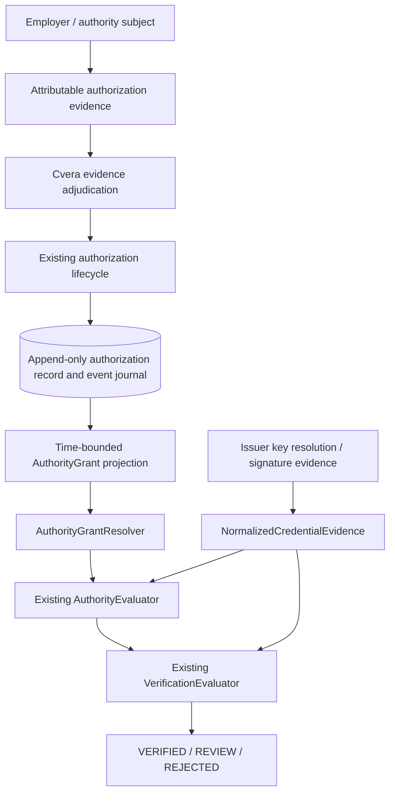

# Cvera Authority Evidence and Grant Resolution

**Status:** Accepted — architecture frozen for v1.0
**Version:** 1.0
**Date:** 2026-10-10
**Canonical repository path:** `docs/architecture/authority-evidence-and-grant-resolution.md`

## 1. Purpose and scope

Define how evidence of an organization's authorization of an issuer becomes a resolvable `AuthorityGrant` for `employment.role` claims. This specification governs the **authorization evidence record**, **lifecycle-to-grant projection**, and **resolver consistency contract**. It does not change the accepted authority-establishment state machine or the existing authority and verification evaluators.

Normative terms **MUST**, **MUST NOT**, and **SHOULD** express requirements for this v1 design.

## 2. Governing boundaries

1. **The organization controls authorization.** Cvera adjudicates evidence of that authorization; Cvera does not create the organization's underlying authority.
2. **Authorization evidence is the source of truth.** `AuthorityGrant` is a derived read model, not evidence of authorization by itself.
3. **Cryptographic issuer identity is not assertion authority.** Valid signatures, keys, issuer metadata, JWKS membership, or domain control MUST NOT independently establish authorization for an employer.
4. **The existing lifecycle is authoritative.** `REQUESTED`, `PENDING`, `APPROVED`, `ACTIVE`, `SUSPENDED`, `REJECTED`, `EXPIRED`, and `REVOKED` retain their accepted meanings and transitions.
5. **Complete history is preserved from inception.** Accepted lifecycle events and evidence adjudication outcomes MUST be durably recorded without destructive overwrites; historical authority MUST be reconstructable.
6. **Resolution is retrieval, not adjudication.** The resolver retrieves projected grants. The existing authority evaluator evaluates their scope, state, and time; the existing verification evaluator determines the final `VERIFIED`, `REVIEW`, or `REJECTED` outcome.
7. **Direct employer confirmation is preferred initially, not mandatory.** Alternative attributable, independently verifiable organizational authorization evidence MAY satisfy Cvera adjudication.

## 3. Minimal authorization evidence record

A durable authorization record MUST preserve, at minimum:

| Field / evidence | Required meaning |
|---|---|
| Authorization ID | Stable identity for this authorization lifecycle; a terminated lifecycle is never resurrected |
| Authority subject ID | Identified employer or organization empowered to authorize the assertion |
| Issuer ID | Identified issuer receiving the authorization; matched to normalized credential issuer identity |
| Claim type | Explicit scope, initially `employment.role` |
| Authorization provenance | Origin and reference to the evidence supporting the organization's authorization |
| Approver authority basis | Evidence that the authorizing person or mechanism was empowered to act for the authority subject |
| Adjudication result | Cvera's attributable decision that required authorization evidence was sufficient or insufficient, with reason and decision time |
| Effective interval | Explicit start and optional end of authorized exercise; no inferred authorization from credential issuance |
| Lifecycle events | Ordered, attributable, timestamped accepted transitions and their established conditions |
| Evidence integrity reference | Stable reference enabling subsequent inspection of the evidence and its integrity; storage and packaging are deferred |

The record MUST bind **issuer ID + claim type + authority subject ID** as a single authorization scope. Approval alone MUST NOT make the grant exercisable: the existing `APPROVED → ACTIVE` transition remains required. Missing, conflicting, or insufficient evidence MUST NOT produce ACTIVE authority. Issuer self-declaration alone is insufficient.

Evidence acceptance MUST be auditable and distinguishable from lifecycle activation. A new authorization after `REJECTED`, `EXPIRED`, or `REVOKED` MUST have a new authorization ID.

## 4. Historical authority journal

The authority registry MUST preserve a durable, append-only logical journal for each authorization from its inception. Every accepted lifecycle transition and adjudication decision MUST have a stable event identity, authorization ID, event type, effective timestamp, recorded timestamp, attributable actor or decision authority, supporting evidence reference, and sufficient ordering information to reconstruct the authorization state. Rejected or unsuccessful attempts MAY be recorded separately but MUST NOT be represented as accepted state transitions.

- Accepted events MUST NOT be silently overwritten or deleted to reflect later changes. Corrections MUST be separately attributable events that preserve the original record and explain the correction; they MUST NOT fabricate an earlier authorization.
- Historical reconstruction MUST distinguish **effective time** (when an event governs authorization) from **recorded time** (when Cvera learned and recorded it). A backdated or corrected event MUST NOT silently rewrite a decision previously made using the evidence available at that time.
- The journal MUST preserve all accepted transitions, including suspension, reinstatement, expiration, and revocation, even when no currently exercisable grant exists. Grant projections MUST be reproducible from that history.
- V1 MUST support reconstruction for internal authority evaluation and audit. It does **not** require a public or general-purpose historical-query API.
- Long-term archival, independently verifiable integrity proofs, signed checkpoints, blockchain infrastructure, and archive retrieval interfaces are deferred. Records MUST retain stable identities and evidence references suitable for future archival migration.
- Indefinite preservation is the design objective, subject to applicable legal and privacy obligations; the specification does not promise literally perpetual physical storage.

## 5. Lifecycle-to-grant projection

The registry MUST derive grant projections from accepted authorization records and effective lifecycle events. It MUST NOT allow an independently edited grant to override its source record.

| Lifecycle state at evaluation time | Grant projection / interpretation |
|---|---|
| `REQUESTED`, `PENDING`, `APPROVED` | No exercisable grant; absent applicable positive authority yields `REVIEW` |
| `ACTIVE` | `active` grant, within the explicit effective interval |
| `SUSPENDED` | Explicit `inactive` grant for the effective suspension interval |
| `REJECTED` | No grant was established; no exercisable grant |
| `EXPIRED` | Preserve historical evidence; no currently effective grant after expiration |
| `REVOKED` | Explicit `inactive` grant from the effective withdrawal time; withdrawal does not retroactively erase prior authority |

`SUSPENDED → ACTIVE` by `REINSTATE` closes the inactive interval and resumes an active interval for the **same** authorization. Terminal states have no outgoing transitions for that authorization.

**Temporal rule:** Grant projections MUST represent effective intervals without applying today's state retrospectively. For a historical evaluation timestamp, the resolver MUST provide the grant intervals needed for the existing evaluator to determine the state at that timestamp. Both `ValidFrom` and non-nil `ValidUntil` are inclusive under the existing evaluator; adjacent contradictory intervals MUST therefore not overlap at a boundary instant. The projection mechanism MUST ensure deterministic, non-conflicting intervals at the supported timestamp precision.

**No arbitrary expiry:** v1 imposes no platform-wide 30/60/90-day authorization lifetime. `ValidUntil` is optional; an open-ended authorization remains subject to later lifecycle changes. Effective timestamps are explicit and attributable.

**Existing evaluator constraint:** An `inactive` grant means explicit negative authority evidence *for the interval it covers*. It MUST NOT be synthesized for `REQUESTED`, `PENDING`, `APPROVED`, `REJECTED`, or merely absent/expired evidence. An expired grant outside its effective interval is noncurrent, not a perpetual negative. This preserves `UNAUTHORIZED` versus `REVIEW`.

## 6. Resolver consistency contract

The existing interface remains unchanged:

```go
ResolveAuthorityGrants(ctx context.Context, issuerID string, claimType string) ([]AuthorityGrant, error)
```

1. The resolver MUST use the normalized **issuer ID and claim type** as retrieval dimensions. It MUST NOT add employer ID as a hidden adjudication filter; the existing authority evaluator matches `AuthoritySubjectID` against the presented employment claim.
2. A successful non-nil or empty grant result (`err == nil`) means resolution completed against a coherent, authoritative registry view. Empty means no applicable records were found in that view, **not** affirmative evidence of unauthorized authority.
3. If completeness, integrity, provenance, projection freshness, or registry availability cannot be established, the resolver MUST return a non-nil error. It MUST NOT silently return an empty successful result or potentially stale grants as authoritative.
4. A non-nil error takes precedence even if grants are also returned. Existing service orchestration maps this to `AuthorityReview / AUTHORITY_RESOLUTION_FAILED`, then final `REVIEW` absent independent negative evidence.
5. Returned grants MUST be traceable to source authorization IDs and accepted lifecycle events. The registry MUST prevent contradictory simultaneously effective grant states for the same authorization and scope; ambiguity MUST NOT be resolved by arbitrary row ordering.
6. The resolver interface has **no timestamp parameter**. Therefore a v1 implementation supporting the service's explicit `EvaluatedAt` MUST return sufficient time-bounded grant history for the authority evaluator to select the applicable interval. A current-state-only snapshot is **not** sufficient for historical evaluation. If a source cannot support the requested semantics, implementation MUST stop for an explicit contract decision rather than silently use current state as historical truth.
7. Historical grant projections MUST preserve the state applicable to each evaluation interval. A later suspension or revocation MUST NOT override an earlier active interval. If the existing evaluator cannot distinguish applicable intervals without ambiguity, implementation MUST stop for an explicit contract decision rather than alter the evaluator's decision semantics implicitly.
8. The registry MUST define an atomic or equivalently coherent read/projection boundary. A transition and its resulting grant projection MUST NOT be observed in a contradictory partial state. Cache or replica staleness that undermines this guarantee is a resolution failure, not successful empty resolution.

The resolver MUST NOT change the meanings of `AuthorityAuthorized`, `AuthorityUnauthorized`, `AuthorityReview`, or any final verification decision.

## 7. Architecture



The diagram describes logical responsibilities, not a storage schema, deployment design, or additional decision engine.

## 8. Required acceptance cases

Before implementation is considered complete, tests MUST establish:

- Accepted, activated authorization within its effective interval resolves as active and can yield `AUTHORIZED`.
- Approval without activation, pending requests, and rejection do not yield exercisable grants.
- Suspension yields inactive authority only during its effective interval; reinstatement restores active authority thereafter.
- Expiration produces no current grant but preserves the historically applicable interval.
- Revocation yields explicit inactive authority from withdrawal onward without retroactively invalidating earlier authorized intervals.
- A successful empty resolution remains distinguishable from resolver failure.
- Resolver failure, including an error accompanied by returned grants, remains indeterminate and cannot authorize.
- Scope matching remains the authority evaluator's responsibility; resolver lookup uses issuer ID and claim type only.
- Conflicting or incoherent projections fail closed rather than selecting an arbitrary grant.
- Evaluation against an explicit historical timestamp does not silently substitute the current authorization state.
- Every accepted transition is preserved, with effective and recorded timestamps, and the state can be reconstructed without overwriting earlier events.
- Corrections preserve prior recorded facts and do not silently retroactively change previously recorded verification decisions.

## 9. Deferred and excluded

Database and schema technology; storage engine; HTTP endpoints; admin interfaces; identity-verification vendors; employer onboarding UI; cryptographic evidence packaging; deployment; caching implementation; commercial metering and billing; new credential formats; credential status and subject-binding implementations; changes to the accepted lifecycle transitions; and changes to the existing authority or final verification decision engines.

## 10. Freeze boundary

This v1.0 architecture is **accepted and frozen**: authorization evidence and adjudication; complete append-only historical journal; lifecycle-to-grant projection; temporal consistency; and resolver completeness. Implementation and repository integration remain separate work. Material changes require an explicit architecture amendment; editorial diagram changes do not.
