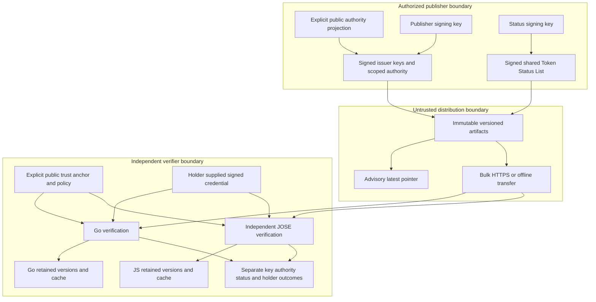

# Stage 4D — Portable trust and status

Local implementation on baseline `a60ae37328de635029227c6503f6cfdabb0fe570`.
Stage 4D genuine publication, migrations, issuance and key operations are not
performed. This is a production-intended artifact boundary validated using
synthetic actors; it is not a production authority establishment exercise.

## Decision and compatibility

Use **OAuth Token Status List draft-21 JWTs** for the existing pinned SD-JWT VC
**draft-18** profile. Draft-18 explicitly references status-list-21 and requires
JWT format for `status_list`. Datatracker was inspected on 2026-11-27: draft-21
is an Active Internet-Draft in the RFC Editor queue, not a published RFC. Do not
silently update either version. W3C Bitstring Status List v1.0 is a 2025 W3C
Recommendation but would introduce its VC credential/entry model into this
SD-JWT profile. It was evaluated and is not implemented as a competing mechanism.

Portable authority is a Cvera-specific **public projection**, authenticated with
standard JWS and public JWKs. It is not a new CA hierarchy or a claim that JOSE
standardizes employer authority. A verifier explicitly pins the publisher key,
issuer identity, trust URI and credential issuer/profile reliance policy.
A key or issuer's self-assertion never creates employer authority.

See [ADR-011](adr/011-portable-trust-and-status.md).

## Implemented architecture and trust boundaries



Each consumer owns its own retained state; neither delegates verification to the
other or to a shared live Cvera service. Private adjudication
records and holder private keys are outside publication. The synthetic generator
holds ephemeral signing keys only until public fixtures are transferred. Isolated
verifiers receive no signing keys, accounts, API connection or database.

## Public material contract

`internal/portabletrust` and `interoperability/stage4d/verify.mjs` independently
validate the same contract. The public trust JWT has protected
`alg=RS256`, `typ=cvera-trust-material+jwt`, and the pinned `kid`. It binds:

- `iss` to the configured publisher; `sub` to the configured HTTPS trust URI;
- positive monotonic `version`, `iat`, exclusive `exp`, and `synthetic` domain;
- `credential_issuer`, pinned `profile`, and `vct`;
- public `keys`: strict RSA JWK plus issuance-validity `from`/`until` intervals;
- `authority`: public employer alias, claim type, reliance policy, effective
  interval and AUTHORIZED, UNAUTHORIZED or UNKNOWN decision;
- `status`: delegated status issuer, exact bulk list URI, public key and explicit
  `purpose=revocation`.

All fields are required and exact; an empty authority array means no applicable
public authorization. Unknown fields, private JWK parameters, nulls, incorrect
field types, ambiguous key IDs and unsupported profile/types are rejected. Keys
require RSA 3072–8192 bits, exponent 65537, `alg=RS256`, `use=sig`, one
`key_ops=verify`, and nonempty key ID. JWT segments and JWK/list encodings are
canonical base64url. Types and protected headers are mutually exclusive; neither
`jku`, embedded untrusted verification keys nor critical extensions are accepted.

A public projection is not its own underlying organizational authorization
proof. For genuine use, the designated publisher must derive assertions from
accepted organizational authorization evidence and the existing complete-history
projection/resolver. This increment deliberately does **not** export a private
SQL grant table or claim to adjudicate genuine organizational authority.

## Authority and key semantics

Key authenticity, key applicability, issuance-time authority and current authority
are separate. A valid credential signature is reported independently of employer
authority and status. An authenticated key outside its issuance-validity interval
has invalid applicability even when its signature mathematically verifies.
Retired public keys may remain available for older credentials; removing a key
makes its verification unavailable, not automatic cryptographic proof of revocation.

Both authority times are reported. Trusted policy explicitly selects:

- `CURRENT`: evaluate authority now, preserving existing database-backed verifier
  reliance semantics. The synthetic canonical scenario uses this mode.
- `ISSUANCE_TIME`: evaluate the signed credential's issuance time. Current loss of
  authority is still reported and does not silently rewrite historical authority.
  The synthetic scenario explicitly selects this mode to demonstrate separation.

No default is inferred from a token. Missing scope or an uncovered time is UNKNOWN;
explicit negative evidence is UNAUTHORIZED. Contradictory overlapping public
intervals are INVALID. This does not alter the frozen internal authority evaluator,
private lifecycle journal, grant resolution or production verification policy.
Retrospective effects of compromise, rescission, supersession and genuine authority
changes require Stage 4F governance; no automatic status mutation is performed.

## Standard status representation

A new synthetic credential receives issuer-protected:

```json
{
  "status": {
    "status_list": {
      "idx": 37,
      "uri": "https://status.synthetic.example.invalid/lists/cohort-a"
    }
  }
}
```

The immutable credential is reused after list updates. Existing credentials are
never rewritten; one lacking a usable status reference remains cryptographically
verifiable but has UNKNOWN portable current status. Original production verification
and issuance routes remain unchanged.

The delegated signer issues `typ=statuslist+jwt` with `iss`, exact `sub` list URI,
`iat`, exclusive `exp`, positive `ttl`, and `status_list={bits:1,lst:...}`. `lst` is
ZLIB-framed DEFLATE, base64url encoded. Index zero uses the least significant bit,
as specified by draft-21. Standard value 0 is VALID and 1 is INVALID. Within the
root-authenticated **revocation-purpose** profile, these normalize to GOOD and
REVOKED; this mapping is not asserted for suspension or other status mechanisms.

Signed application extensions `cvera_version`, `cvera_vct`,
`cvera_credential_issuer` and `synthetic` bind updates to the intended version,
credential issuer, profile and trust domain. These are Cvera policy extensions,
not new cryptography or a second status format. Compression is bounded to 1 MiB
input/output and one ZLIB stream. The local privacy policy requires at least
16 KiB / 131072 entries, including padding. Missing applicable index is UNKNOWN;
malformed references and invalid signatures/bindings are INVALID. A revoked status
does not turn a valid credential signature into a signature failure.

## Freshness, cache and retained-state rollback protection

Trusted verification time is explicit. Default maximum status age is **900
seconds inclusive**: 899 and 900 may be GOOD; 901 is STALE. `maxStatusAgeSeconds`
is local policy, never read from the credential/request/status artifact. Signed
`ttl` and `exp` can shorten eligibility but cannot extend it beyond local policy.
Expired authentic evidence is STALE; future-dated or malformed evidence is INVALID.
Trust material has a separate configurable `maxTrustAgeSeconds`, initially 900.
Stale trust can still supply historically authenticated public key bytes to report
signature integrity, but cannot establish successful current reliance.

Each consumer retains authenticated raw artifacts, version and issue time scoped
to the configured root/key, trust URI and credential issuer. Updates are checked
atomically against known version, time and same-version content. Lower versions,
backward issue times and same-version equivocation fail closed. Valid revocation
updates cannot be replaced by an older good list. Invalid signatures/structures
do not poison retained state. Status retention also atomically requires the authenticating trust descriptor
to remain current, preventing superseded work from poisoning status high-water
marks. Positive decisions atomically recheck both captured artifacts against retained
state; an evaluation superseded while in flight cannot finish positively.
The Go store is mutex-protected; JS performs its
atomic check-and-retain synchronously after cryptographic validation.

State is verifier-owned **in-memory** retained state, not a holder-provided input.
This provides session/process rollback detection, including concurrent submissions.
A restart loses learned high-water marks. Authenticated higher versions are
current assertions, not proof of truthful or irreversible revocation history;
version checks alone do not prohibit an authorized publisher clearing a bit.
Issuer lifecycle controls, no-index-reuse and any reinstatement policy require
the separately governed Stage 4F source workflow. Independent trusted minimum versions
can initialize a floor; first contact without that floor establishes freshness,
not absolute rollback resistance. Genuine multi-process use requires protected,
durable atomic high-water-mark storage and anti-reset procedures. No claim of
stateless, crash-persistent or universal rollback protection is made.

Absent material is UNKNOWN. A retrieval failure explicitly marked UNAVAILABLE may
use a sufficiently fresh authenticated cached artifact. Invalid new material is
not silently replaced by cached good material. Expired or stale cache cannot
establish success, even if private Cvera services are down. HTTP cache headers
never override signed timestamps, expiry, TTL or verifier freshness policy.

## Publication, acquisition and failure handling

`interoperability/stage4d/distribution.mjs` provides an artifact-only publisher:

1. Validate the signed, public-schema-whitelisted trust/status packet against
   configured anchor and policy; require fresh applicable artifacts.
2. Obtain an exclusive local publication lock. Do not break an ambiguous lock.
3. Authenticate the old packet, even if expired, before comparing monotonic versions
   and issue times. Reject rollback/equivocation.
4. Create immutable version files using exclusive creation; identical bytes are
   idempotent. Fsync files, then atomically rename an advisory `latest.json` pointer.
5. Release the lock. Before the pointer rename, a failure leaves the old pointer
   intact; orphaned immutable files never establish trust by filename alone.
   Failure during/after rename or directory sync can leave an ambiguous committed
   pointer. The error flags `commitMayHaveOccurred`; reconcile actual signed files
   and pointer before any retry. No successful receipt is returned on failure.

`receive(directory)` reads bounded nonsymlink artifacts through a restricted
pointer grammar. Path traversal, malformed pointers and corrupted artifacts are
INVALID; an absent pointer is UNAVAILABLE. A pointer referencing absent files is
corruption and blocks publication, rather than resetting version history. Use an operator-owned, access-controlled
directory on a local filesystem with the required atomic rename/fsync semantics;
the library is not a hostile-filesystem sandbox or an object-store transaction.

`acquire({trustURL,statusURL})` supports explicit operator-configured HTTPS bulk
URLs, correct media types, no credentials, no redirects, 5-second timeout and
1-MiB responses. Credential-supplied URLs are not fetched automatically. The list
index and credential identifier are never sent. Offline transfer through `receive`
is equally supported. Consumers authenticate the bytes irrespective of transport.

The existing `scripts/publish.ts` and automatic Spaces workflow are unchanged.
Their immutable revision plus short-lived latest-pointer pattern is reused; their
legacy raw JWKS/status/audit globs are **not** treated as authenticated portable
authority. New artifacts are not added to that automatic workflow or a production
trust namespace. Static hosting/object storage can distribute the validated bytes
later, with explicit approved namespace, content types, HTTPS and cache settings.
There is no new mandatory central verification service or managed database.

## Stage 4B/4C integration and outcome semantics

`VerifyCredential`/`verifyCredential` extract the existing profile's cryptographic,
claim-binding and temporal evaluation without accepting Stage 4B fixture authority
or status hints. Their default Stage 4B entry points are unchanged.

Stage 4C receives a **trusted code callback**, not a serializable evidence override.
The Stage 4D adapter binds it to the exact credential, verification time and expected
subject. The trusted, read-only evaluator is rechecked immediately before
presentation release and before nonce consumption; newly known revocation or
supersession denies the operation without consuming the challenge.
Authenticated requests, separate disclosure permission, holder consent,
issuer-protected holder key, audience/nonce/hash, temporal checks and atomic replay
remain enforced. The current demonstration adapter is synthetic only; no production
presentation route or consent UI is introduced.

Standalone Stage 4D reports `trustMaterial`, `verificationKey`, `issuanceAuthority`,
`currentAuthority` and the separate Stage 4B credential dimensions. Its best result
is `ELIGIBLE_WITHOUT_HOLDER`, never an unqualified VERIFIED. A holder presentation
still needs all Stage 4C gates. Missing mandatory trust inputs fail closed.

## Privacy and threat model

Public artifacts contain only keys, public scope assertions and shared status
bits. Schema tests reject reviewer identities, private evidence fields, private
JWKs and credential enumerations. No credential, subject identifier, claim body,
receipt or internal grant/review ID is published. The holder's credential is a
separate input, never an artifact written by the publisher.

A list provides group distribution rather than a per-credential status API. It
does not prove 131072 actual holders exist: padding is not an anonymity guarantee.
List membership, stable disclosed indices, timing, population size and collusion
can still enable correlation. Public organizational authority scopes require
publication consent; private source evidence must remain private. Use shared
caches, bulk acquisition/offline transfer and considered cohort allocation for
genuine deployment. Do not expose a credential-to-index enumeration endpoint.

Explicit anchors are security-critical trusted configuration. A malicious trusted
publisher or dishonest issuer, compromised keys, altered local state/clock, unsafe
root reconfiguration and compromised holder endpoints remain threats. This code
cannot infer that a manually mislabelled synthetic anchor is genuine. Signed
synthetic markers and a verifier policy denying synthetic roots prevent artifact-
controlled promotion; genuine root onboarding requires independent authorization.
The Stage 4B GitGuardian exception is not extended to any new material.

## Normative traceability

| Source inspected on 2026-11-27                                                                                                              | Applied subset                                                                                | Evidence                                                                                  |
| ------------------------------------------------------------------------------------------------------------------------------------------- | --------------------------------------------------------------------------------------------- | ----------------------------------------------------------------------------------------- |
| [SD-JWT VC draft-18](https://www.ietf.org/archive/id/draft-ietf-oauth-sd-jwt-vc-18.html), §§3, 7                                            | Existing pinned profile; issuer-protected status reference; JWT list token                    | Existing adapter unchanged, new status reference and compatibility vectors                |
| [Token Status List draft-21](https://www.ietf.org/archive/id/draft-ietf-oauth-status-list-21.html), §§4–8, 12–13                            | JWT type, URI/index binding, ZLIB, bit ordering, signed TTL/expiry, bulk/offline distribution | Both consumers; golden bit vectors, freshness and privacy tests                           |
| [RFC 7517](https://www.rfc-editor.org/rfc/rfc7517.html), §§4–5                                                                              | Public JWK fields and key identification                                                      | Strict public JWKs bound inside signed issuer/profile material                            |
| [RFC 7515](https://www.rfc-editor.org/rfc/rfc7515.html), §§4–5                                                                              | Protected headers, signature integrity, explicit algorithm/key                                | Independent jwt/v5 and JOSE verification, wrong-key/type/tampering vectors                |
| [RFC 8725](https://www.rfc-editor.org/rfc/rfc8725.html), §3                                                                                 | Algorithm restrictions, explicit typing, issuer binding, mutually exclusive token rules       | Strict type/header/schema/encoding checks and cross-token negatives                       |
| [RFC 9901](https://www.rfc-editor.org/rfc/rfc9901.html), §§4.1.2, 4.3, 7.3                                                                  | Preserve holder confirmation and KB-JWT validation                                            | Stage 4C regression and portable-trust presentation scenarios                             |
| [OpenID4VP Final](https://openid.net/specs/openid-4-verifiable-presentations-1_0-final.html), §§5–8                                         | Preserve request authentication and presentation binding                                      | Trusted adapter plus Stage 4C request/consent/replay regression                           |
| [W3C VC Data Model 2.0](https://www.w3.org/TR/vc-data-model/), [Bitstring Status List 1.0](https://www.w3.org/TR/vc-bitstring-status-list/) | Trust-role/status/privacy guidance; alternative evaluated                                     | Explicit role separation and privacy analysis; no W3C status or JSON-LD conformance claim |

Cvera-specific choices are public authority assertion vocabulary, revocation-purpose
normalization, version extensions, strict schemas, list-size/compression bounds,
trust maximum age and supported reliance modes. This is a bounded implemented
subset, not full SD-JWT/OAuth/OpenID/W3C protocol certification.

## Reproduction, operational prerequisites and limitations

From the repository root, install the existing locked dependencies and use Go
1.26.10 plus cached Docker `node:20`:

```sh
python3 interoperability/stage4d/run.py --isolated
python3 interoperability/stage4b/run.py --isolated
python3 interoperability/stage4c/run.py --isolated
cd apps/evt-api-go
GOTOOLCHAIN=go1.26.10 go test -race ./internal/portabletrust ./internal/holderpresentation ./internal/portableverify -count=1
GOTOOLCHAIN=go1.26.10 go vet ./...
```

The generator rehearses local publication and a loopback HTTP distribution server
inside its isolated process. Private ephemeral keys never enter the separate
read-only verifier process. Only generated public artifacts and test credentials
are transferred; no Cvera application, DB, accounts or private keys are available.
The same intended credential is issued once per run, reused for two presentations
and survives good-to-revoked status transitions unchanged. Adversarial re-signed
fixtures are test artifacts, not additional successful intended issuances.

Durable [validation evidence](../validation/stage4d/README.md) records exact results,
acceptance and rendering validation. Fixtures are generated at runtime; new JWTs
and private keys are not tracked. Remote integration and release results are recorded in the integration PR closure;
these local artifacts precede that phase.

Before genuine use, separately authorize: public organizational scope publication,
anchor provenance, accepted projection/export completeness, status-index allocation
and durable uniqueness, status lifecycle write authorization, signer custody,
monotonic publication counters, timely refresh/availability, protected verifier
high-water-mark storage and key/status retention through credential lifetimes.
Existing static object hosting can serve artifacts; no new managed database has
been justified by this increment. Real source/lifecycle adapters and historical
reliance governance remain Stage 4F. Broader holder/export UX remains Stage 4E.
No lifetime validity, production key rotation, root recovery, complete distributed
rollback protection, genuine issuer authority or production deployment is established.
