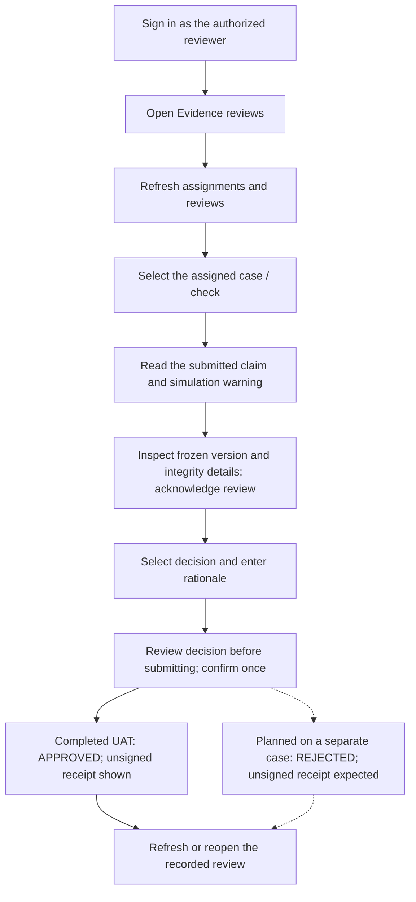
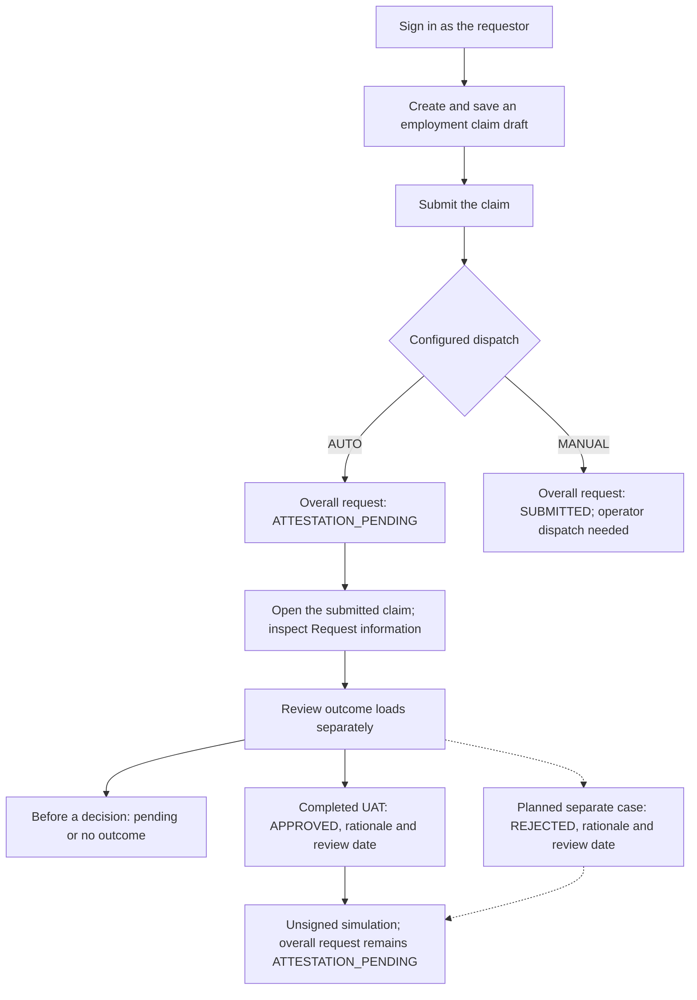
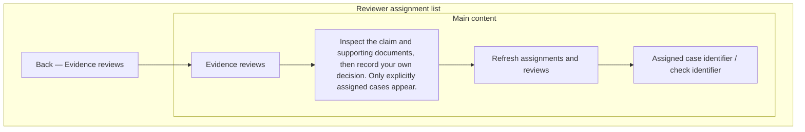
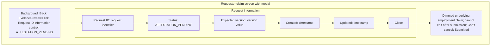

# Cvera — UX Refresh & Review Brief

Prepared for Janet · November 22, 2026

This packet describes the current experience. It is a starting point for discussion, not a proposed redesign or a statement of agreed consulting deliverables.

## 1. Why we're meeting

We met through IIW, and you have seen Cvera before. On November 21, I reached out to reconnect, share progress and discuss the product. You responded enthusiastically and offered meeting availability. Thank you for making time.

I promised a short refresh packet with current workflows, screenshots and recent testing findings. The aim is to give you enough context to evaluate the experience independently, especially what a first-time reviewer understands without a walkthrough. The date and scope of your earlier review are not recorded here, so this packet does not assume a particular earlier version.

## 2. Cvera in brief

Cvera enables people to submit structured claims and allows authorized reviewers to evaluate them. The example in this packet concerns employment: an employer, job title and dates.

The current simulated user acceptance test (UAT) records a review decision and an unsigned receipt. It does not constitute employer-authorized verification or issue a signed credential. A review decision and the overall request status are separate: the tested request displays APPROVED while its overall status remains ATTESTATION_PENDING.

Three kinds of evidence are distinguished throughout:

- **Observed:** visible in the four supplied screenshots.
- **Repository-derived:** behavior present in the current implementation, including steps not shown in those screenshots.
- **Planned:** the separate rejection exercise, which has not been executed.

The screenshots are references for the wireframes below; they are not embedded or committed with this document. Names, dates and technical identifiers in the wireframes are replaced by neutral placeholders.

## 3. What's changed since Janet last saw Cvera

These are verified current capabilities, rather than a dated before/after comparison:

- An assigned reviewer can inspect the submitted employment claim, its frozen version and integrity information, then record a simulated claim-only decision with a rationale.
- The reviewer can reopen the completed review and see its decision, rationale, reviewer identifier, timestamp and unsigned receipt identifier.
- The original requestor can reopen the submitted claim and see the review outcome, rationale and date, alongside a separate overall request status.
- Both sides explicitly describe the simulation boundary. The requestor view says the outcome is unsigned and non-authoritative, not employer verification or a signed credential.

One simulated approval has completed production UAT. Persistence, authorization, claim binding and the absence of signed issuance were checked separately; the requestor also confirmed the visible outcome. Simulated rejection is supported by the implementation and automated coverage, but a human production rejection journey remains planned.

## 4. Who uses the product

| Role      | What they do in this workflow                                                                                     | Boundary                                                                                      |
| --------- | ----------------------------------------------------------------------------------------------------------------- | --------------------------------------------------------------------------------------------- |
| Requestor | Submits their structured employment claim and returns to see its status and review outcome.                       | Sees outcomes for their own request; does not receive reviewer privileges.                    |
| Reviewer  | Opens assigned cases, reads the claim, records a decision and rationale, and sees the receipt.                    | Needs case-specific authorization; cannot review their own claim.                             |
| Operator  | Prepares the simulated case, required check, frozen claim binding, simulation classification and reviewer access. | Setup is separate from the requestor/reviewer screens; it does not confer employer authority. |

An employer queue assignment and a case-review grant serve different purposes. A reviewer role or employer assignment alone does not make every case available.

## 5. Current reviewer journey

The assignment list and completed approval are observed in reviewer screenshots A and B. The acknowledgment, decision selection and confirmation steps are repository-derived because the screenshots show the review after completion.

**Diagram 1 — Reviewer journey: completed approval and planned separate rejection**

The planned branch is not a second action on the approved record. A completed decision is immutable. A separate request, case, check, binding and reviewer grant are needed for the rejection exercise. If a submission result is uncertain, the implemented guidance is to refresh and reconcile the recorded review before attempting anything again.

## 6. Current requestor journey

Creation and submission are repository-derived. The submitted claim, information modal and approved outcome are observed in requestor screenshots C and D and supported by the completed requestor UAT.

**Diagram 2 — Requestor journey: lifecycle and review outcome stay separate**

The submitted claim cannot be edited through this screen. Review outcomes reload when the detail screen receives focus. Loading, unavailable, stale-version and error states are implemented; they are not shown in the reference screenshots. A review from a different claim version is not presented as a current decision.

## 7. Current-screen wireframes

These are schematic transcriptions of the observed information hierarchy, not pixel layouts or proposed screens. Arrows within each wireframe indicate reading order, not additional interactions. Placeholder values describe the type of information shown. Color, spacing and responsive behavior should be assessed in the running product.

### A. Reviewer assignment list

Source: supplied image 3, a desktop view. The assignment is displayed as a technical case/check identifier.

**Diagram 3 — Observed reviewer assignment list**

### B. Reviewer claim detail and completed review

Source: supplied image 4. The selected technical assignment appears above the employment claim. The completed review appears below the claim and required check.

**Diagram 4 — Observed reviewer claim detail and recorded approval**

```mermaid
flowchart TD
    subgraph WB["Reviewer claim detail"]
        WB1["Selected case identifier / check identifier"]
        subgraph WBClaim["Employment claim"]
            WB2["Simulated UAT — evidence review only. Not an employer-authorized verification."]
            WB3["Employer: simulation identifier; Claim: claim type; Issuer: issuer address"]
            WB4["Read the complete submitted claim; compare documents where present"]
            WB5["Submitted claim JSON: employer, role, dates and employment details"]
            WB6["Frozen claim version: version value; Claim SHA-256: digest value"]
            WB7["Show request identifiers and integrity details"]
            WB2 --> WB3 --> WB4 --> WB5 --> WB6 --> WB7
        end
        WB8["Required check: check identifier"]
        subgraph WBReview["Review the submitted claim — simulated UAT"]
            WB9["Review without a document creates an unsigned receipt, not employer verification or a credential"]
            WB10["Unsigned claim review recorded: APPROVED"]
            WB11["Rationale: Claim is correct."]
            WB12["Reviewer: identifier; Recorded: original timestamp; Receipt: identifier"]
            WB9 --> WB10 --> WB11 --> WB12
        end
        WB1 --> WB2
        WB7 --> WB8 --> WB9
    end
```

### C. Requestor information modal

Source: supplied image 2, a mobile view. The modal overlays a dimmed submitted claim. The status badge remains visible behind it.

**Diagram 5 — Observed Request information modal**

### D. Requestor review outcome

Source: supplied image 1, a mobile view. The review outcome sits beneath the overall status and above the employment claim fields.

**Diagram 6 — Observed requestor approval outcome**

```mermaid
flowchart TD
    subgraph WD["Requestor submitted claim"]
        WD1["Back; Evidence reviews link; Request ID information control"]
        WD2["Status: ATTESTATION_PENDING"]
        subgraph WDOutcome["Review outcome"]
            WD3["Simulated UAT — Unsigned, non-authoritative review. Not employer verification or a signed credential."]
            WD4["Check: check identifier"]
            WD5["Review decision: APPROVED"]
            WD6["Claim is correct."]
            WD7["Reviewed: original review date in local time"]
            WD8["Review decisions are separate from the request status shown above."]
            WD3 --> WD4 --> WD5 --> WD6 --> WD7 --> WD8
        end
        WD9["Claims: employer name; job title; start and end dates"]
        WD10["This claim can't be edited after submission; Can't cancel; Submitted"]
        WD1 --> WD2 --> WD3
        WD8 --> WD9 --> WD10
    end
```

## 8. What we learned from Tara

One reviewer, Tara, supplied this qualitative feedback:

> "The flow felt fine, but ... as a user seeing this for the first time ... I was not super clear where I needed to go and what things were for. Given I knew the purpose, I could get through it but it wasn't very explanatory ... very simple buttons..."

This is one person's account, not a finding about every reviewer. It raises questions about orientation and explanation that Janet can explore independently. Successful approval and persistence checks establish that this tested workflow completed; they do not establish that the experience is self-explanatory.

## 9. Areas for Janet to explore

| Area                           | Neutral exploration prompt                                                                        |
| ------------------------------ | ------------------------------------------------------------------------------------------------- |
| Orientation                    | What does a new reviewer think they are being asked to do?                                        |
| Navigation                     | How do they decide where to go next, and how do they recover their place?                         |
| Assignment discoverability     | How do they recognize the case that needs their attention?                                        |
| Labels                         | Which terms are understood immediately, and which require interpretation?                         |
| Understanding the claim        | Can they explain what the person is claiming after reading the screen?                            |
| Decision confidence            | What information do they use to choose a decision and write a rationale?                          |
| Technical information          | How do identifiers, JSON, versions, digests and receipts affect understanding or trust?           |
| Simulation messaging           | What authority does the reviewer believe their action carries?                                    |
| Feedback after decisions       | What tells them the decision was recorded, and what do they expect next?                          |
| Reviewer/requestor consistency | Do both sides form compatible understandings of the same outcome?                                 |
| Mobile and desktop             | What changes when reading, navigating and entering a rationale on each layout?                    |
| Accessibility                  | How usable is the flow with keyboard, screen reader, text enlargement and different visual needs? |

These are research prompts, not predetermined defects or proposed interface solutions.

## 10. Review scenarios

**Scenario A — First-time reviewer evaluates and approves a simulated employment claim.**

Status: **Completed UAT.** An authorized reviewer inspected the submitted claim and recorded APPROVED with the rationale “Claim is correct.” The reviewer receipt and requestor outcome were checked. The original requestor confirmed that reopening shows the decision, rationale, original review date and unsigned/non-authoritative labeling while the overall request stays ATTESTATION_PENDING.

**Scenario B — First-time reviewer evaluates a separate claim with insufficient supporting evidence and records rejection.**

Status: **Planned; not yet executed.** The proposed rationale is: “Insufficient supporting evidence to substantiate the claim in this simulated review.” This concerns evidence sufficiency, not a declaration that truthful employment details are false. Tara has not completed a rejection review; her participation requires her agreement.

This exercise needs a new request, case, check, frozen binding and reviewer grant. It must not reuse or alter Scenario A's completed approval. Participant agreement, production prerequisites and explicit authorization precede any setup or decision. Rejection is expected to remain an unsigned simulation with a separately pending request status; the human end-to-end result still needs verification.

## 11. Questions for Janet

- What is your first impression of the task and its purpose?
- Where would you begin an independent review, and why?
- What do you understand the reviewer to be approving or rejecting?
- How do you interpret APPROVED alongside ATTESTATION_PENDING?
- Which information helps you reach a decision, and which needs explanation?
- What would you want to investigate with people who have not seen Cvera before?
- Which observations would you prioritize, and what evidence would help assess their impact?

Your professional judgment is welcome, including observations outside these prompts. This packet does not presume a formal engagement or agreed deliverables.

## 12. Findings worksheet

| Screen/step | Observation | Impact | Recommendation | Priority | Notes |
| ----------- | ----------- | ------ | -------------- | -------- | ----- |
|             |             |        |                |          |       |
|             |             |        |                |          |       |
|             |             |        |                |          |       |

## 13. After the review

We will consolidate the discussion and distinguish observations, open questions and recommendations. Janet's feedback will inform a future prioritized UX backlog, with impact and supporting evidence considered before work is selected. No redesign or implementation is approved by this packet.

Source notes for follow-up: the four owner-supplied screenshots are the primary visual reference. The current implementation is captured in [EvidenceReviewScreen](../../apps/evt-ui-expo/screens/EvidenceReviewScreen.tsx), [RequestorRequestDetailScreen](../../apps/evt-ui-expo/screens/RequestorRequestDetailScreen.tsx), [RequestorNewRequestScreen](../../apps/evt-ui-expo/screens/RequestorNewRequestScreen.tsx), and [RequestorReviewOutcomes](../../apps/evt-ui-expo/components/RequestorReviewOutcomes.tsx). The [requestor review-outcomes contract](../api/requestor-review-outcomes.md) explains disclosure and outcome states. Completed Stage 2B UAT and Tara's feedback are owner-supplied evidence; planned Stage 3 behavior is not presented as an observed production result.
